# ⚡ Escola de Tecnologias — Colégio Anchieta Porto Alegre

> **Portal Unificado de Simuladores, Laboratórios Interativos e Inteligência Artificial Educacional**  
> Desenvolvido para as atividades pedagógicas de **Game Design, Programação, Robótica e Competições (OBR / FLL)** do **Colégio Anchieta** (Porto Alegre - RS).  
> **Mentores:** Prof. Sandro & Prof. Gabriel.

---

## 🧭 Visão Geral

O **Portal do Laboratório de Tecnologias** reúne **20 ferramentas e simuladores autorais** executados 100% no navegador (Client-Side e APIs modernas), sem necessidade de instalações complexas. O ambiente é projetado com estética cyberpunk limpa, suporte universal a **Modo Escuro / Claro**, **seletor de idiomas (Português / Inglês)**, **painel administrativo do professor com PIN** e **sistema de proteção e identificação de compatibilidade por dispositivo (Celular vs. Computador)**.

---

## 🛤️ Estrutura das 4 Trilhas de Aprendizado

```mermaid
flowchart TD
    Hub["⚡ Portal Laboratório de Tecnologias"]
    
    Hub --> Track1["🎨 Game Lab: Design"]
    Hub --> Track2["💻 Game Lab: Programação"]
    Hub --> Track3["🤖 Robótica"]
    Hub --> Track4["🏆 Treinamento Robótica"]
    
    Track1 --> T1A["Gerador de GDD"]
    Track1 --> T1B["Gerador de Mapas 2D"]
    Track1 --> T1C["Montador de Tilesets"]
    Track1 --> T1D["Estúdio de Prompts & ComfyUI"]
    Track1 --> T1E["Imagens Binárias & Matriz"]
    Track1 --> T1F["Criador de Timelines"]
    Track1 --> T1G["Feedback de Jogos"]
    
    Track2 --> T2A["Lab de Física 2D"]
    Track2 --> T2B["Tabelas de Status & Balanceamento"]
    Track2 --> T2C["Simulador FSM"]
    Track2 --> T2D["Assistente IA - Games ✨"]
    
    Track3 --> T3A["Lei de Ohm (Kit Arduino)"]
    Track3 --> T3B["Giro de Robô 2D"]
    Track3 --> T3C["Hacker Lockpicking (Serial)"]
    Track3 --> T3D["Assistente IA - Robótica ✨"]
    
    Track4 --> T4A["OBR Placar Treino"]
    Track4 --> T4B["Seguidor de Linha (PID)"]
    Track4 --> T4C["Telemetria & Coaching (IA)"]
    Track4 --> T4D["Prancheta de Táticas FLL"]
    Track4 --> T4E["Assistente IA - Treinamento ✨"]
```



---

## 🛠️ Catálogo Completo de Ferramentas (20 Simuladores)

| # | Ferramenta | Trilha Principal | Compatibilidade | Descrição Pedagógica |
|:---:|:---|:---|:---:|:---|
| **01** | [`gerador-gdd/`](./gerador-gdd/) | 🎨 Game Lab: Design | 🖥️ Computador | Criação estruturada de Game Design Documents com exportação local em JSON e Markdown. |
| **02** | [`gerador-mapas/`](./gerador-mapas/) | 🎨 Game Lab: Design | 🖥️ Computador | Grid interativo para level design de fases de plataforma 2D com exportação em PNG e JSON. |
| **03** | [`montador-tilesets/`](./montador-tilesets/) | 🎨 Game Lab: Design | 🖥️ Computador | Empacotador de spritesheets em grade (16x16, 32x32, 64x64) com remoção de fundo para Construct 3 e GameMaker. |
| **04** | [`seletor-prompts/`](./seletor-prompts/) | 🎨 Game Lab: Design | 🖥️ Computador | Estúdio de montagem de prompts visuais em português para SDXL, trava SFW integrada e launcher do ComfyUI local. |
| **05** | [`binario-pixelart/`](./binario-pixelart/) | 🎨 Game Lab: Design | 🖥️ Computador | Laboratório de matriz binária (1-Bit e 2-Bits), decodificador de enigmas e exportação de sprites para o Piskel. |
| **06** | [`criador-timelines/`](./criador-timelines/) | 🎨 Game Lab: Design | 🖥️ Computador | Planejamento da progressão e escopo de fases com termômetro inteligente de viabilidade. |
| **07** | [`feedback-jogos/`](./feedback-jogos/) | 🎨 Game Lab: Design | 🖥️ Computador | Formulário anônimo e dashboard visual de avaliação UX e playtesting dos jogos dos alunos. |
| **08** | [`lab-fisica-2d/`](./lab-fisica-2d/) | 💻 Game Lab: Programação | 🖥️ Computador | Simulador interativo em Canvas a 60 FPS para teste de gravidade, forças vetoriais, atrito e colisão elástica. |
| **09** | [`tabelas-status/`](./tabelas-status/) | 💻 Game Lab: Programação | 🖥️ Computador | Tabela editável de atributos numéricos, simulador de tempo de combate (TTK), curvas de nível e exportação em `camelCase` para Construct 3 e GameMaker. |
| **10** | [`simulador-fsm/`](./simulador-fsm/) | 💻 Game Lab: Programação | 🖥️ Computador | Editor visual de Máquinas de Estados Finitos com nós conectáveis e transição dinâmica de lógica. |
| **11** | [`assistente-ia/?area=games`](./assistente-ia/index.html?area=games) | 💻 Game Lab: Programação | 🖥️ Computador | Chatbot com IA para suporte a Game Design, Construct 3, GameMaker GML e avaliação estilo Metacritic. |
| **12** | [`simulador-ohm/`](./simulador-ohm/) | ⚙️ Robótica | 🖥️ Computador | Lei de Ohm interativa com peças reais do Kit Arduino (protoboard, resistores coloridos, LEDs, 9V/5V) em circuitos série e paralelo. |
| **13** | [`simulador-giro-robotico/`](./simulador-giro-robotico/) | ⚙️ Robótica | 🖥️ Computador | Estudo da cinemática diferencial com tração diferencial de rodas, odometria e trajetórias 2D. |
| **14** | [`hacker-lockpicking/`](./hacker-lockpicking/) | ⚙️ Robótica | 🖥️ Computador | Desafio interativo de lockpicking conectado ao hardware físico de Arduino via Web Serial API ou simulador virtual. |
| **15** | [`assistente-ia/?area=robotica`](./assistente-ia/index.html?area=robotica) | ⚙️ Robótica | 🖥️ Computador | Agente de IA para mentoria de robótica com Lego, placas Arduino, sensores ultrassônicos e ponte H. |
| **16** | [`obr-placar-treino/`](./obr-placar-treino/) | 🏆 Treinamento Robótica | 📱 Celular & PC | Cronômetro oficial e pontuador de regras da OBR (Olimpíada Brasileira de Robótica) com desconto automático por tentativas. |
| **17** | [`simulador-seguidor-linha/`](./simulador-seguidor-linha/) | 🏆 Treinamento Robótica | 🖥️ Computador | Simulador físico de pista com calibração em tempo real de ganhos PID (Kp, Ki, Kd), posição de sensores e engrenagens. |
| **18** | [`telemetria-coaching/`](./telemetria-coaching/) | 🏆 Treinamento Robótica | 📱 Celular & PC | Diagnóstico automático de voltas por IA Multimodal (Gemini via Cloudflare Worker) com timeline de oscilações e ajuste fino de PID. |
| **19** | [`prancheta-fll/`](./prancheta-fll/) | 🏆 Treinamento Robótica | 🖥️ Computador | Prancheta tática para traçado de rotas autônomas, marcação de missões e notas de estratégia da temporada FLL. |
| **20** | [`assistente-ia/?area=treinamento`](./assistente-ia/index.html?area=treinamento) | 🏆 Treinamento Robótica | 🖥️ Computador | Suporte inteligente para algoritmos de competição em Python, montagem estrutural e estratégias de pontuação. |

> [!NOTE]
> **Convenção de Nomenclatura de Código Didático (`camelCase`):**  
> Toda a codificação, variáveis e snippets entregues aos estudantes (GameMaker GML, Construct 3, fórmulas matemáticas) seguem rigorosamente o padrão `camelCase` (ex: `maxHp`, `scoreValue`, `damage`, `spd`), alinhando a prática pedagógica com os padrões ensinados nas aulas.

---

## 🌟 Recursos Centrais da Plataforma

### 1. 🌐 Suporte Bilíngue Global (`lang-toggle.js`)
- Alternância instantânea entre **Português (`🇧🇷 PT`)** e **Inglês (`🇺🇸 EN`)** sem recarregar a página.
- Sincronização automática entre abas abertas e persistência no `localStorage` (`titanTech_lang`).
- Emissão do evento nativo `titanLanguageChanged` para re-renderização de componentes gráficos e Canvas.

### 2. 🌓 Tema Escuro & Claro Universal (`theme-toggle.js`)
- Alternância suave de tema (`dark` / `light`) com paleta otimizada para alto contraste e conforto visual em sala de aula e projetores.
- Tratamento contra FOUC (Flash of Unstyled Content) com script síncrono no `head`.

### 3. 🔐 Painel do Professor (`portal-professor/`)
- Acesso seguro protegido por PIN individual para cada mentor:
  - **Prof. Gabriel:** Trilha de Games (Game Lab: Design & Programação).
  - **Prof. Sandro:** Trilha de Robótica & Treinamento Competitivo.
- Permite **ativar ou desativar a visibilidade de qualquer um dos 18 simuladores** em tempo real no portal dos alunos, utilizando `localStorage` compartilhado e evento de `storage`.

### 4. 📱 Proteção e Consciência de Dispositivo
- Badges visuais indicando compatibilidade:
  - `📱 Celular & PC`: Otimizados com layout mobile-first touch para uso direto ao lado das pistas de robótica.
  - `🖥️ Computador`: Indicados para atividades de mouse, teclado e múltiplos painéis no laboratório.
- Em dispositivos móveis, cliques em simuladores exclusivos de computador exibem um modal elegante de aviso com a opção de retornar ou prosseguir mesmo assim.

### 5. 🤖 IA Multimodal Otimizada (Cloudflare Worker Proxy)
- Na ferramenta de **Telemetria & Coaching**, vídeos de voltas gravados em pistas reais de robótica são fatiados em quadros cronológicos compactos com estampas de timestamp (`T=MM:SS.ms`), contornando tetos de payload e entregando diagnóstico de oscilações, perda de linha e calibração de Kp/Kd em segundos.

---

## 🚀 Como Executar Localmente

Como todas as ferramentas são estáticas (HTML5, CSS3 e JavaScript puro):

1. **Clone o repositório:**
   ```bash
   git clone https://github.com/DarkSehna/escola-de-tecnologias.git
   cd escola-de-tecnologias
   ```

2. **Inicie qualquer servidor web local:**
   - **Com Python 3:**
     ```bash
     python -m http.server 5500
     ```
   - **Com Node.js (npx):**
     ```bash
     npx serve .
     ```
   - **Com a extensão Live Server (VS Code):**
     Clique com o botão direito em `index.html` e escolha **"Open with Live Server"**.

3. **Acesse no navegador:**
   - Portal Inicial: `http://localhost:5500/`
   - Painel do Professor: `http://localhost:5500/portal-professor/`

---

## 👥 Mentores & Autoria

- **Prof. Gabriel** — Game Design, Level Design, Programação de Jogos e Inteligência Artificial.
- **Prof. Sandro** — Robótica Educacional, Automação, Competições OBR & FLL e Hardware Arduino.
- **Colégio Anchieta** — Porto Alegre, RS, Brasil.

---

*© 2026 Escola de Tecnologias — Todos os direitos reservados.*
